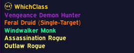
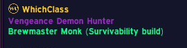
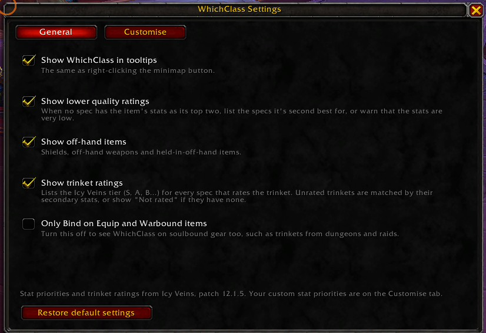
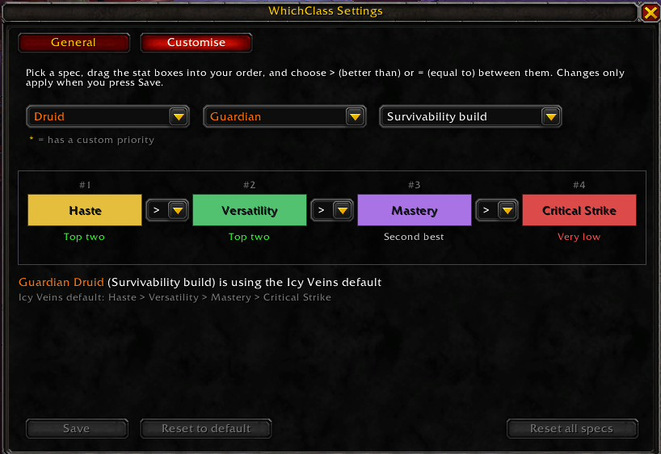
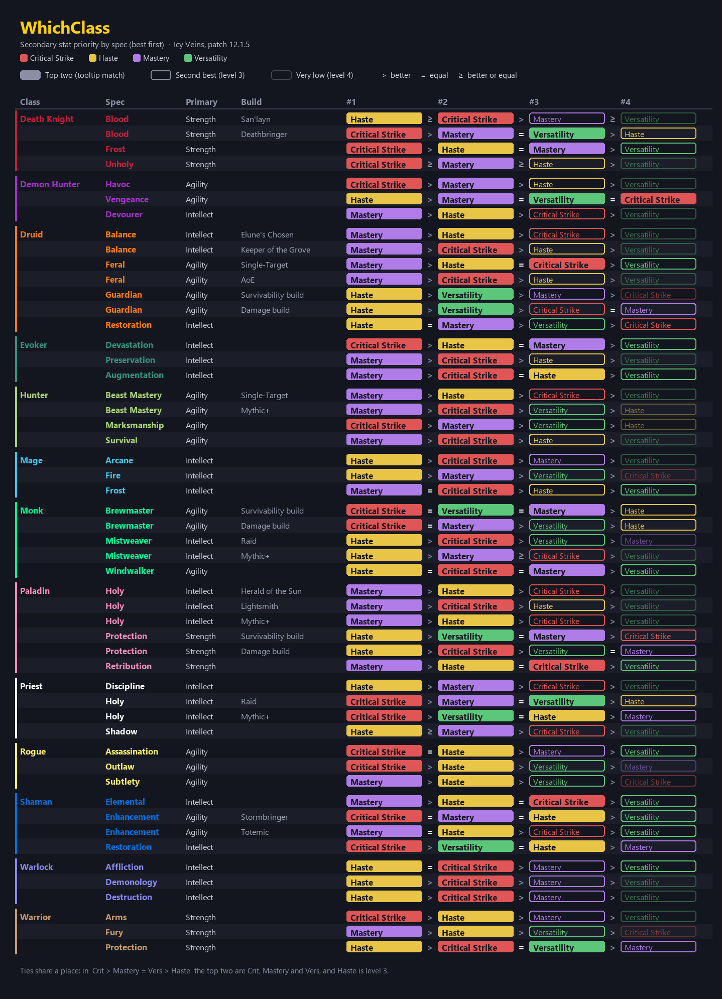

#  WhichAlt

A World of Warcraft addon that adds a short section to gear tooltips showing **which class and spec the item's secondary stats suit**. For example, a leather item with Haste and Versatility lists *Guardian Druid*, because those are its top two stats.

Stat priorities and trinket ratings come from [Icy Veins](https://www.icy-veins.com/wow/) (patch 12.1.5, Midnight). You can override any spec's priority in the game.

<p>
  
  &nbsp;
  
</p>

## Features

- **Spec matches in the tooltip**, in class colours. When a spec has different priorities for different builds (hero talents, Raid vs Mythic+, survivability vs damage), the matching build is shown in brackets, such as *Brewmaster Monk (Survivability build)*.
- **Only specs that can use the item**: it checks armor type, weapon type, shields and the item's main stat (Strength, Agility or Intellect).
- **Second best and very low ratings**: when no spec has the item's stats as its top two, it lists the specs it's second best for, or warns that the stats are very low for everyone.
- **Trinket ratings**: the Icy Veins tier (S, A, B…) for every spec that rates the trinket.
- **Settings window** to turn each part on or off.
- **Customise tab**: drag a spec's stats into your own order and save it, or add your own roles.
- **Light on performance**: nothing runs on a timer. Results are worked out once per item and cached.

## Installing

1. Go to the [latest release](https://github.com/Psybernet/WhichAlt/releases/latest) and download **`WhichAlt-vX.Y.Z.zip`** under *Assets*.
2. Extract it into `World of Warcraft\_retail_\Interface\AddOns\`. You should end up with an `AddOns\WhichAlt` folder.
3. Restart the game, or type `/reload` if it was already running.

To try the newest unreleased changes instead, use **Code → Download ZIP** and rename the extracted folder from `WhichAlt-main` to **`WhichAlt`**. The game only loads it if the folder name matches the `.toc` file.

A **WA** button on the minimap shows that it has loaded.

## Using it

Hover over any piece of gear. The WhichAlt section appears at the bottom of the tooltip.

| Action | What it does |
|---|---|
| Left-click the minimap button | Opens settings |
| Right-click the minimap button | Turns WhichAlt tooltips on or off (the icon greys out while off) |
| Drag the minimap button | Moves it around the minimap |
| `/whichalt` or `/walt` | Opens settings |
| `/walt minimap` | Hides or shows the minimap button |

### How items are rated

Each spec has an order for the four secondary stats, for example Blood Death Knight (Deathbringer): **Critical Strike > Mastery = Versatility > Haste**. Stats joined by `=` are tied.

- **Top match**: both of the item's secondary stats are in the spec's best two places. Tied stats share a place, so in the example above Critical Strike, Mastery and Versatility all count.
- **Second best**: otherwise, both stats are within the first three priority levels, counting tied stats as one level. In the example, Haste is level 3, so any pair with Haste is second best.
- **Very low**: everything else.

The full list for every spec is in the reference image below.

## Settings



| Option | Default |
|---|---|
| Show WhichAlt in tooltips (same as right-clicking the minimap button) | On |
| Show lower quality ratings ("second best" and "very low") | On |

**Only show tooltip for:** WhichAlt only appears on items whose binding is ticked. Off-hand items and trinkets can be switched off too.

| Option | Default |
|---|---|
| Bind on Equip items | On |
| Warbound items (including Warbound until equipped) | On |
| Soulbound items (including dungeon and raid drops that bind when picked up) | Off |
| Off-hand items (shields, off-hand weapons and held items) | On |
| Trinkets (Icy Veins tier, or matched by stats if unrated) | On |

### Customising stat priorities



1. Pick a **Class**, **Spec** and **Role**. Roles are the Icy Veins builds (hero talents, Raid or Mythic+, survivability or damage) plus any you've made.
2. Drag the stat boxes into your order, and choose `>` (better than) or `=` (equal to) between them. Under each box you can see how the tooltip will treat that stat.
3. Press **Save**. The row flashes green and the role shows as using your custom priority. Specs you've changed get a gold `*` in the dropdowns.

**Reset to default** puts the current role back to the Icy Veins priority. **Reset all specs** clears every custom priority and role, after asking first.

### Your own roles

Press **New role** under the Role dropdown, type a name and press **Create** (or Enter). The new role starts as a copy of the priority on screen, so you can set up the order first and then save it as a role. Edit it and press **Save** like any other role.

Your roles show in the tooltip in brackets, for example *Windwalker Monk (Mastery stack)*. When a spec has only one Icy Veins priority, that one shows as *(Default)* once you've added a role. **Delete role** removes the selected role, after asking first.

## Stat priority reference



## Data files

The data is kept in readable tables so it's easy to update when Icy Veins changes its recommendations.

| File | What it holds |
|---|---|
| [`SpecData.lua`](SpecData.lua) | Each spec's main stat and secondary stat priority, with notes on the format at the top |
| [`TrinketData.lua`](TrinketData.lua) | Trinket tiers per spec, matched by item ID so it works in every game language |
| [`Data.lua`](Data.lua) | Which armor and weapon types each class can use |

If a row in `SpecData.lua` or `TrinketData.lua` has a mistake, WhichAlt prints the row in chat when you log in.

### Tools

Both need Python 3.

```bash
pip install beautifulsoup4 html5lib pillow
```

Rebuild `TrinketData.lua` from the Icy Veins trinket rankings:

```bash
python tools/update_trinkets.py
```

Redraw the reference image from `SpecData.lua`:

```bash
python tools/make_reference.py
```

## Releasing a new version

Version numbers follow [semantic versioning](https://semver.org/): `1.3.1` for a fix, `1.4.0` for new features, `2.0.0` for big changes.

1. Change `## Version:` in [`WhichAlt.toc`](WhichAlt.toc) to the new number.
2. Add a section for it at the top of [`CHANGELOG.md`](CHANGELOG.md).
3. Commit and push as usual.
4. Tag the version and push the tag:

   ```bash
   git tag v1.4.0
   ```

   ```bash
   git push origin v1.4.0
   ```

GitHub then builds `WhichAlt-v1.4.0.zip` (just the addon folder, without the images and tools) and publishes it on the [Releases](https://github.com/Psybernet/WhichAlt/releases) page with the changelog as release notes. The build stops with an error if the tag and the `.toc` version don't match. You can follow it under the repository's **Actions** tab.

**CurseForge:** once the project exists there, add its ID to `WhichAlt.toc` as `## X-Curse-Project-ID: 123456`, add a CurseForge API token as a repository secret named `CF_API_KEY`, and remove the `#` from the `CF_API_KEY` line in [`.github/workflows/release.yml`](.github/workflows/release.yml). Each tag will then upload to CurseForge too.

## Credits

Stat priorities and trinket ratings: [Icy Veins](https://www.icy-veins.com/wow/) class guides. WhichAlt isn't affiliated with Icy Veins or Blizzard Entertainment.

## License

[MIT](LICENSE) © 2026 Martin Heine
